# 👋 Hi there, I'm Xujiangjing!

🎓 Currently pursuing an MSc in Artificial Intelligence at the University of Edinburgh  
🎓 Graduated with First Class Honours in BSc Computer Science at King's College London

🔬 **Research Interests:**  
Machine Learning · Reinforcement Learning · AI Agents · ML Systems

⚙️ **Research & Projects:**  
- Fuzzing theorem provers (Isabelle, Zipperposition, Vampire)
- Exploring bugs in ATP pipelines and proof translation
- Operating systems (virtual memory, ELF loading, page faults)
- Machine learning and AI applications  

🧠 Interested in building reliable, verifiable, and intelligent systems
---

## ⏱️ My Coding Activity (WakaTime)

---

## 📊 GitHub Stats

---

## 💻 Languages I Use Most

---

✨ Profile powered by WakaTime & GitHub Readme Stats
